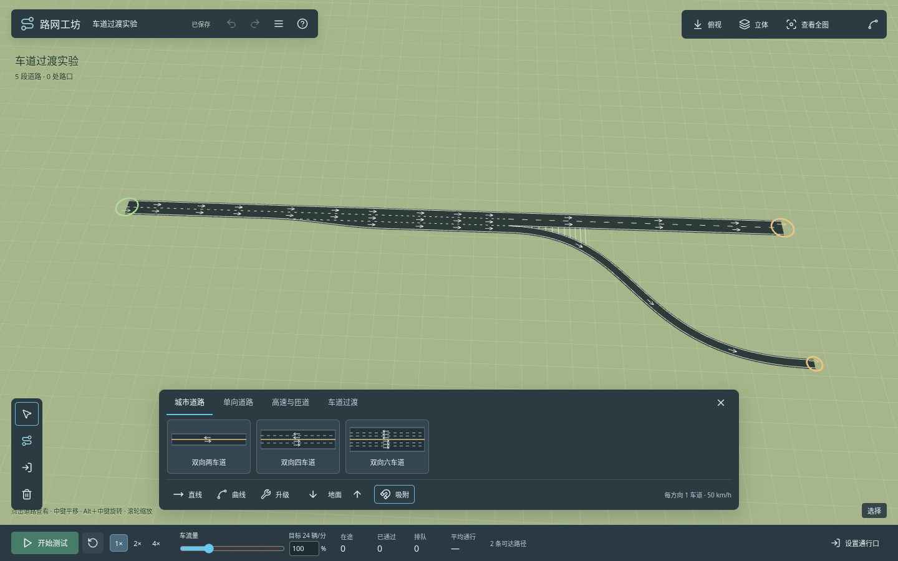

# 路网工坊 · Interchange Lab

本地运行的三维道路与立交实验，使用 TypeScript、Three.js 和 Vite。重点是道路建造、平滑 **2 → 3 → 2＋1** 车道过渡，以及通过改路网观察交通。



## 快速开始

需要 **Node.js 24+** 和 npm。应用是纯静态前端，不需要数据库或后端服务。

```bash
git clone https://github.com/hongwbao/roadLab.git
cd roadLab
npm ci
npm run dev
```

打开 http://localhost:5173/ 。开发服务允许局域网访问；在其他设备使用运行机器的局域网 IP。

```bash
npm run build
npm run preview
```

构建产物位于 `dist/`，`preview` 仅用于本地检查构建。生产部署见 [部署说明](docs/DEPLOYMENT.md)，提供 GitHub Pages、Docker Compose 和普通静态服务器三种方式。

## 建造道路

1. 在屏幕底部中央选择道路资产，鼠标立即显示蓝色道路预览。分类包含城市道路、单向道路、高速与匝道。
2. 左键单击起点、终点建造直线；曲线依次单击起点、弯曲控制位置、终点。拖动左键只旋转镜头，不放置道路。普通道路可连续接着画，后续路段会沿上一段的切线平滑起步。右键单击返回上一个绘制点，Esc 退出。
3. 接近端点或路段时自动吸附，显示琥珀色圆环、道路高亮和文字；同时支持方向和网格对齐。斜向接入已有道路端点时，预览会按目标端点方向生成平滑曲线。按住 Alt 临时关闭吸附。单向接口支持中线／左缘／右缘偏移对齐，起点和终点均可选择，显示偏移米数；可用底部“对齐”按钮，或聚焦地图后按 Tab 切换；开启车道吸附且有多个候选时，Tab 优先切换目标车道。
4. 同高道路交叉或接入中部自动生成路口。路口内部留空白路面，城市路口绘制斑马线，车辆沿曲线转弯。高架交叉保持独立。
5. 按 **B** 切换拆除，悬停变红，点击删除道路。再次按 B、右键或 Esc 退出；撤销可恢复。
6. 按 **U** 或点击“升级”，选择替换道路、加车道或中央隔离带，在道路上预览并左键应用，右键恢复／取消（加车道时为减车道）。选择“平滑节点显示”或“取消节点平滑”时，悬停并点击真实连接节点；左键应用当前选项，右键取消该节点的平滑显示，同一路两端独立。
7. 选择模式点击道路，拖动端点、曲线柄修改几何；Alt＋左键拖动道路可整体移动。右侧只显示简短信息和相关操作。

在“升级”中选择“加车道”，选用单向道路资产，在已有路段的一侧悬停预览并点击扩宽。支持单向 2→3、双向 2＋2→2＋3 等非对称断面，原有车道位置保持不变；城市资产栏提供 1＋2、2＋3，正反向数量可独立调整。新建和扩宽默认直接连接，空余车道可以继续接入其他普通道路；可在“升级 → 平滑节点显示”中单独调整节点外观，车道连接与通行逻辑保持不变。不再需要专用分合流资产，旧地图几何保留。单车道可吸附到多车道的指定同向车道，多车道可选择连续车道组，Tab 切换候选。新拉长路按约 120 米自动分段。详见 [单侧扩宽与手动过渡](docs/ROAD_EXPANSION.md)、[车道级道路建造](docs/ROAD_BUILDING.md) 和 [自动分段](docs/ROAD_SEGMENTS.md)。

所有道路统一每车道 **4 米**，包括城市道路、高速和匝道。旧存档和模板载入编辑器时同步转换；中央隔离带额外占宽，例如双向 2＋2 加 2 米隔离带为 18 米，不含路肩。

节点平滑只补足可见铺面、调整局部标线；不移动车道端点，不改变合法连接、寻路、停线或车辆轨迹。运行中应用、取消及视觉撤销／重做保留车辆、路网和信号时钟。替换道路可调整当前正反向车道数量，预览与落地一致；右键恢复上次断面并随地图保存。详见 [道路升级与右键操作](docs/ROAD_UPGRADES.md)。

“升级 → 中央隔离带”支持添加／替换、移除及 1／2／4 米宽度，适用于双向道路。实体占用真实宽度并调整车道位置，在路口和斑马线前收口；单侧扩宽后的斜交路口已按真实铺面修正斑马线与停止线。详见 [中央隔离带与升级工具](docs/ROAD_MEDIAN.md)。

按 **J** 或点击左侧车道连线工具，可编辑实际连接的所有道路节点，包括普通直／弯接、自动分段、车道数变化、双向／非对称、偏移及分合流。选择节点后，可依次点击入车道实心圆点与出车道空心圆点，也可按住入点拖到出口松开。支持指定出口车道、多出口、禁止全部出口和恢复自动；全部出口关闭后仍可选中节点恢复连接。规则进入真实寻路，随地图保存并支持撤销／重做；普通节点编辑保持原有逻辑路口、停车及信号行为。详见 [路口车道连线](docs/JUNCTION_LANE_CONNECTIONS.md)。

直线与三点曲线现通过原式道路工具事务生成，包含道路宽度相关的控制点修正、曲线拟合和高程线性化；预览与提交共用结果。新的曲线不再使用固定比例的二次曲线转换，既有存档保留原控制点。在网址后增加`?construction=source`可体验已接入鼠标建路的原式吸附实验入口。它保留源优先级、相对格长及控制点；完整原式节点合并仍在接线，实验入口部分端点连接有已知差异，默认使用兼容吸附。详见 [原式道路建造](docs/CS2_ROAD_BUILDING.md)。

按 **K** 或点击红绿灯工具，在路口中心添加信号灯。新建十字路口默认依次放行东西直行、东西左转、南北直行、南北左转，每相位均含四向右转。可以逐相位修改时长和各进口的转向权限，并保存命名方案、导入其他路口或导出／导入 JSON。相邻自定义相位中持续允许的实际转向保持绿灯，默认四相位的四向右转因此全周期保持绿灯；退出放行的方向仍经历黄灯和实际清空，车辆车尾离开后才解除占用。面板与地图灯色同步显示部分方向保持绿灯。原自动感应、保护分相与逐进口模式继续可用；旧存档保持原配置。详见 [红绿灯](docs/TRAFFIC_LIGHTS.md)。

## 通行口与交通测试

按 **I**，点击道路端点设置外部通行口；也可点击“自动识别外部通行口”。双向道路同一端点同时承担入口与出口，单向道路按行驶方向自动判断。**右键点击通行口取消**，或在道路信息中点击该通行口的取消按钮。

两个端点都设置通行口的孤立双向道路可以双向测试。通行口不会在删除后自动恢复；再次主动执行自动识别时会重新补齐外部端点。

底部车流量可调 **0–400%**。新建入口的100%默认是整条入口总计 **50辆/模拟分钟**，再平均分给该入口的所有车道；4个入口均100%时共200辆/分钟。按 **I** 在“车流测试”中选择入口，调整入口百分比、各出口比例，或展开修改100%基准。出口默认均分，修改一项后其余按原比例分配；悬停或聚焦出口行，会显示对应入口到出口的地图虚线。运行中可调，保留现有车辆、路线和统计，配置随地图保存。旧存档保留实际流量。详见 [入口车流与出口比例](docs/TRAFFIC_DEMAND.md)。

车辆出发前先按出口比例决定目的地，再按道路限速、车辆极速和已采样交通速度估算用时，优先选择预计最快的合法道路路线；行驶中实时选择车道，默认沿既定路线向前预判 **500 米**，包括自定义车道连线，提前逐条变道。可在“地图菜单 → 交通 AI 设置”调整为100–2000米，运行中生效并随地图保存。在所有满足既定路线和合法连线的候选车道中，优先选择前方真实车辆最少的目标；默认500米统计沿普通连续分段累计，排除自身、后方与对向车辆。每秒复核，平局保持稳定，目标即使相隔多条车道也只逐条安全变入。普通择道不会为制造空隙主动减速，变道本身也不额外降速；真实前车、安全间距、红灯、弯道及限速仍可要求减速。详见 [实时车道预判](docs/EARLY_LANE_PLANNING.md)。

车辆连续驶出真正的外部出口；路口内部被裁切的终点仍按原规则停车，红灯与真实前车保护继续生效。

默认交通模型为 `cs2-derived`，依据用户提供的天际线2 1.6.0f1托管实现移植。后台 Worker 在共享主／从车道图上寻路，普通小汽车执行原式选道、跟车、曲率限速、车道重叠与预约、车辆状态和向量运动，再通过独立插值显示。边界需求映射为测试交通角色；复杂分合流仍有可见穿模，完整导航窗口、原道路生成、居民、停车、行人及其他交通方式仍需继续接合，不能视为完整交通复刻。

车辆按源16组更新，入口使用原出生状态；尚未正式生成的车辆暂不显示。正常拥堵可以存在，无灯路口也可能按原路权在空路口减速。信号时钟使用模拟时间，暂停及倍率同步。旧IDM/MOBIL与5秒预测模型保留为内部 `legacy` 对照路径，其文档与压力结果属于历史实现。当前范围、原方法对照和已知问题见 [复现记录](docs/CS2_RECONSTRUCTION.md)、[当前运行链路](docs/CS2_SIMULATION.md) 和 [功能差距](docs/CS2_FEATURE_GAPS.md)。

## 快捷键

| 操作                      | 按键 / 鼠标                                     |
| ------------------------- | ----------------------------------------------- |
| 选择 / 直线 / 曲线 / 升级 | V / L / C / U                                   |
| 切换拆除 / 设置通行口     | B / I                                           |
| 返回上一步 / 退出工具     | 右键单击 / Esc                                  |
| 取消通行口                | 选择或通行口模式，右键点击标记                  |
| 移动地图                  | 右键拖动、WASD、方向键或画面边缘；Shift 加速    |
| 旋转 / 俯仰               | 左键拖动、Q / E、T / G                          |
| 缩放                      | 滚轮滚动、中键上下拖动、中键单击拉近一级、R / F |
| 建造高度升降              | PageUp / PageDown（每次 8 米）                  |
| 框选 / 追加选择           | Shift＋空白拖动 / Shift＋点击                   |
| 撤销 / 重做 / 复制        | Ctrl Z / Ctrl Shift Z / Ctrl D                  |
| 保存 / 导出               | Ctrl S / Ctrl Shift S                           |
| 定位选中道路或全图 / 俯视 | Shift F / H                                     |
| 删除选中道路 / 测试暂停   | Delete / Space                                  |
| 车道候选／接口对齐        | 聚焦地图后 Tab；Shift＋Tab 反向切换车道候选     |
| 返回上一个绘制点          | 右键单击或 Backspace（绘制过程中）              |

**苜蓿叶立交示例**采用用户确切命名存档“苜蓿叶立交 · 2主线＋2辅道 改进版”：保留重建主线、匝道、8条自定义车道连接、8个出入口及8米高架。32段两车道主线与8条四车道出入口原路限速120 km/h，其余道路100 km/h；四车道道路向外延长40米，再按120米上限自动分为120段，最长约111.23米。默认总基准为每入口50辆／模拟分钟，全局100%。从地图菜单重新载入示例即可使用，当前地图及本机存档不自动替换。最新一轮在完整配套源码 `57201680` 上完成类型检查、生产构建及4项关键生产包检查，并在线上同项复验通过；道路71核心／18浏览器与交通183专项结果分别保留，不相加为整合数量。这些有界结果不代表完整高压交通验收。详见 [苜蓿叶测试地图](docs/CLOVERLEAF.md)。

左上角点击**地图菜单**，可选择**重置为空白地图**或**载入测试地图**（用户提供的 18 段车道过渡地图），也可载入其他示例。地图替换前会确认，替换后可撤销。

菜单中的**本机存档**支持输入名称保存当前地图，并从列表载入或删除。使用已有名称保存时会先确认覆盖。当前进度仍会自动保存；命名存档保存在当前浏览器及网址的本地存储中，刷新页面后仍可从菜单载入。跨浏览器或设备迁移时，可展开“导入与备份文件”使用 JSON 文件。

本轮修复手动横移车道连接纵向空间不足导致的急转、低速和倒车。车道连线界面、实际车辆、兼容路径和铺面共用真实连接曲线与裁切位置；原多出口／禁行规则保留，零横移普通接缝保持透明。生产包双向各208个连接区样本最低约16.67米／秒、最大偏角约5.71度，无倒车；开关平滑显示的路网与实际轨迹严格一致。原输入120秒有界回放完成量95→136，相关接头急转和低于1米／秒车辆均降至0；这不是全路网无拥堵或零重叠保证。

当前版本已合并用户的非对称断面替换与连续驶出外部出口更新，并完成节点平滑显示与交通逻辑分离。3→5的五个出口共用同一逻辑截面，开关显示不移点，可真实连接并驶入第五道；合法最少车辆选道、无变道专属减速、连续绿灯和接收车道保护保留。全局撤销按正常历史顺序处理，live参数历史不会重置运行。旧版本已清空并保存的 `to=[]` 无法与主动禁行区分，**需要手动重新连线或恢复含原目标的历史／存档**。整体道路重构与独立的非对称交叉节点识别问题暂缓；正常高流量排队和历史高压重叠风险仍保留。详细源版本、测试边界及回退信息见[验证记录](docs/verification.json)。

## 开发与验证

```bash
npm run check             # 格式、类型、构建和核心测试
npx playwright install chromium
npm run test:e2e          # 浏览器建造操作回归
npm run test:smoke        # 构建产物的浏览器检查，先执行 build
```

Linux CI 可使用 `npx playwright install --with-deps chromium` 安装系统依赖。测试默认使用 Playwright Chromium；本地发现系统 Chrome 时可复用，也可以用 `PLAYWRIGHT_CHROMIUM_EXECUTABLE_PATH` 指定可执行文件。测试截图和统计输出至忽略提交的 `artifacts/`。

核心测试和浏览器交互测试覆盖道路编辑、交通模拟、地图菜单与本机存档。GitHub Actions 的 CI 还会构建 Docker 镜像并在容器中做真实浏览器检查。

| 目录                            | 职责                                                 |
| ------------------------------- | ---------------------------------------------------- |
| `src/core/`                     | 道路类型、曲线、断面、自动拓扑、资产、路口和吸附算法 |
| `src/editor/`                   | 编辑事务、鼠标键盘、历史、保存和导入导出             |
| `src/render/`                   | Three.js 路面、标线、预览、选取和车辆实例            |
| `src/simulation/`               | 寻路、车流、跟车、出口准入、汇流和车身碰撞           |
| `src/main.ts` / `src/style.css` | 应用入口、游戏式 HUD 和布局                          |
| `tests/`                        | 核心、浏览器交互和生产构建测试                       |
| `deploy/`                       | Nginx 生产静态服务配置                               |
| `.github/workflows/`            | CI 与可选的 GitHub Pages 发布                        |

[寻路与性能](docs/PATHFINDING.md) · [架构说明](docs/ARCHITECTURE.md) · [部署说明](docs/DEPLOYMENT.md) · [CSUR 参考与偏移吸附](docs/csur-design.md) · [功能映射](docs/feature-map.json) · [验证记录](docs/verification.json)

## 原型边界

主目标是桌面键鼠操作。窄屏提供紧凑布局和可滚动资产栏，未实现完整触控编辑。源码移植中的世界拓扑与完整交通行为尚未全部对齐，高流量分合流穿模和复杂路网长期行为仍在修正。道路工具还保留本项目的车道附件、手动启用的过渡和几何适配；坡度15%、净空5米、过渡长度15米是本项目建议值。平行道路、环岛工具、网格与隧道工具仍暂缓。全应用无需在线账号或云端接口。

实际交通内核增加[提前变道准备](docs/EARLY_LANE_PLANNING.md)：根据车道连线提前选择出口车道，逐条相邻变道，并检查目标车道前后空隙。

道路细节：选中道路可修改5–160 km/h最高限速；升级替换可按中线、原车道或边缘对齐，鼠标横移自动选择，Tab切换，并显示隐藏旧路面的蓝色预览。车道虚线固定为3米实线段／6米间隔。苜蓿叶示例的匝道接头会裁掉重复铺面及内部边线，采用水平接入后再爬坡。操作与验证范围见 [道路升级](docs/ROAD_UPGRADES.md) 和 [苜蓿叶地图](docs/CLOVERLEAF.md)。

偏移吸附接头现在同样支持路口车道连线：按J后点击分流／汇流位置，可以将任意合法入车道连到指定出车道，并保存、撤销或恢复自动。苜蓿叶改进版保留8条用户自定义车道连接；已有地图也会重新识别有效的偏移车道接触。

工具切换会复用已有路面网格，选择描边、控制点显隐和网格开关不再触发整张地图的道路重建。性能原因、测量范围与缓存失效回归见[界面性能](docs/UI_PERFORMANCE.md)。

出发选路不再混合里程与舒适度成本，也不再随机缩放路线成本；限速会影响选择，但完整的红灯等待预测仍未实现。详见 [预计用时与道路选路](docs/ROUTE_CHOICE.md)。
